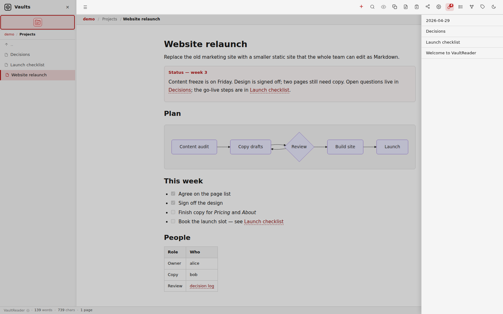
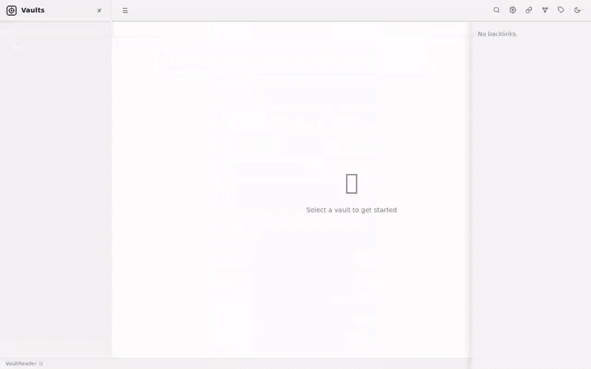
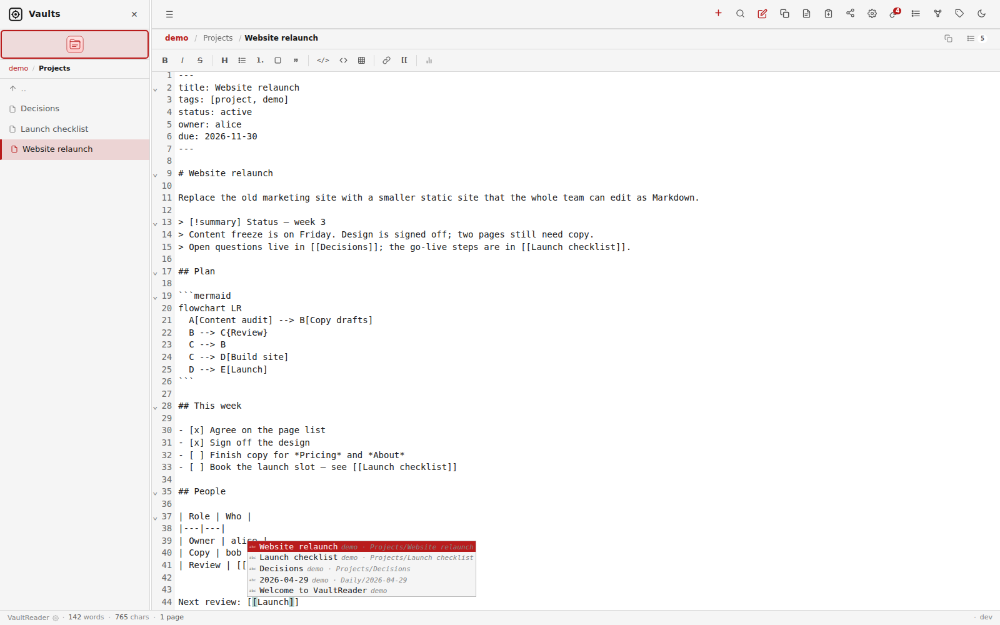
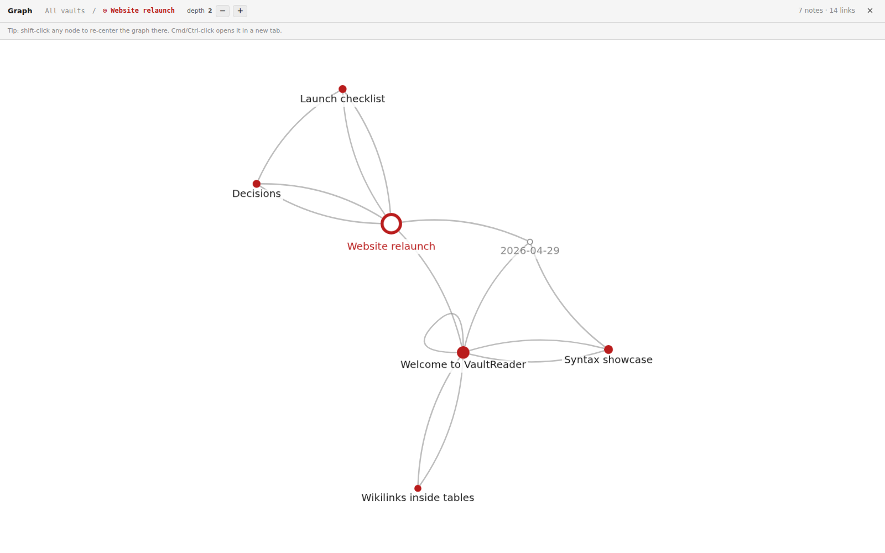
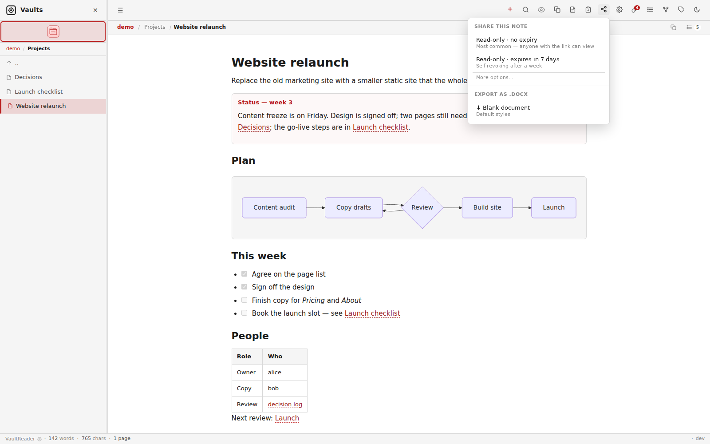
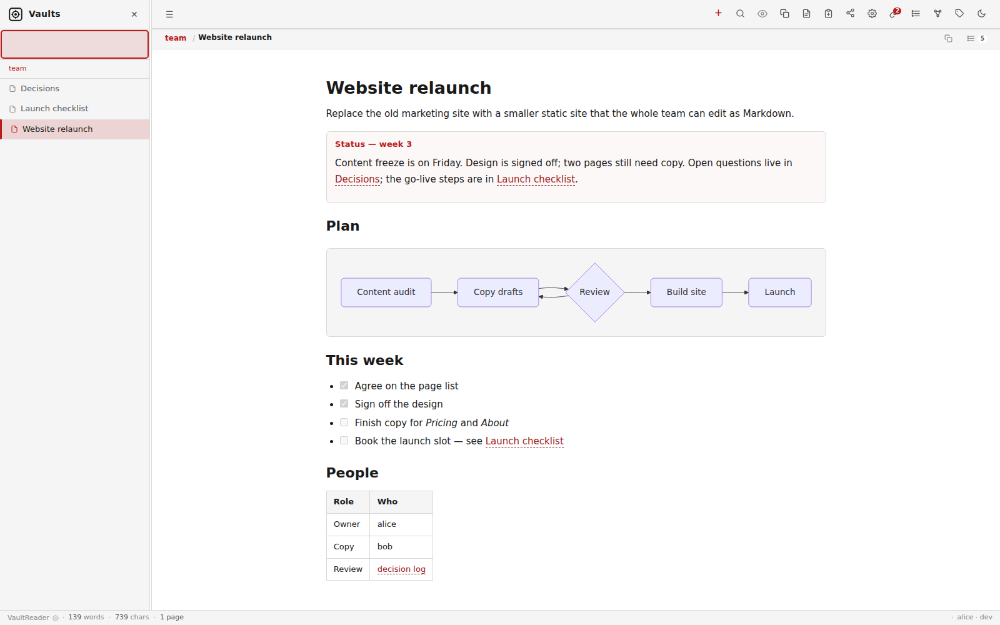

# VaultReader

**Share part of your Obsidian vault with a teammate — behind your own auth.**

VaultReader is a self-hosted web reader and editor for Obsidian-style Markdown vaults. It works on the folders you already have: no import, no database, one Go binary. Run one instance for yourself, and a second one that only sees the folder a colleague should have.

[](https://github.com/joaompfp/vaultreader/actions/workflows/ci.yml)


**Live demo:** <https://joao.date/vaultreader> (resets every hour)



## Why

- **Give someone one folder, not the whole vault.** A second container mounts only `work/team`; your other notes are not in its filesystem.
- **Use the login you already run.** Authelia, oauth2-proxy, authentik or any forward-auth proxy logs people in. VaultReader reads the `Remote-User` header and can refuse requests without it.
- **No extra seats or sync service.** The files stay where they are. Obsidian, Syncthing, git and VaultReader all work on the same Markdown.
- **Know who changed what.** Every edit goes into an append-only audit log with the user name; a small host-side script can turn it into per-author git commits.
- **Read and edit from any browser** when you are away from your own machine.

## Quick start

Try it with the bundled demo vault:

```bash
git clone https://github.com/joaompfp/vaultreader.git
cd vaultreader
docker run --rm -p 8080:8080 \
  --user "$(id -u):$(id -g)" \
  -v "$PWD/examples/vaults:/vaults" \
  -v "$PWD/examples/appdata:/appdata" \
  ghcr.io/joaompfp/vaultreader:latest
```

Open <http://localhost:8080>. Edits to the demo go into `examples/vaults/demo`; `git checkout examples/ && git clean -fd examples/` undoes them.

Use your own vaults:

```bash
mkdir -p appdata
echo '{"rw_paths": ["MyVault"]}' > appdata/config.json   # without this, everything is read-only
docker run -d --name vaultreader -p 8080:8080 \
  --user "$(id -u):$(id -g)" \
  -v /path/to/MyVault:/vaults/MyVault \
  -v "$PWD/appdata:/appdata" \
  ghcr.io/joaompfp/vaultreader:latest
```

Each folder directly under `/vaults` is one vault, so mount a single vault as `/vaults/<name>`, or mount a parent folder that holds several. `--user` makes new files belong to you rather than root (the image runs as root otherwise).

With Docker Compose: copy [`docker-compose.example.yml`](docker-compose.example.yml) to `docker-compose.yml`, set the two paths, and run `docker compose up -d`. The file also shows the Traefik labels for running it behind forward-auth.

Without Docker (Go 1.21 or newer):

```bash
go build -o vaultreader .
./vaultreader -vaults ./examples/vaults -appdata "$(mktemp -d)" -port 8080
# or: make run-demo   (PORT=8081 if 8080 is taken)
```

Without a `config.json` in `-appdata`, the demo is read-only too; `make run-demo` copies `examples/appdata` (which allows writes to `demo`) to a temp dir for you. DOCX export needs [`officecli`](https://github.com/iOfficeAI/OfficeCLI) on `PATH`; the Docker image includes it.

Before you expose it to the internet, read [docs/security.md](docs/security.md). VaultReader has no login of its own.

## Features



**Reading**
- Wikilinks with aliases, image embeds, backlinks, outline, frontmatter as chips
- Callouts, Mermaid diagrams, KaTeX math, tables, task lists
- Several vaults side by side, with custom icons
- Dark mode; works on phones

**Editing**
- CodeMirror 6 editor with a Markdown toolbar and `[[` autocomplete
- Paste or drop images (saved to `attachments/` next to the note, as Obsidian does)
- Autosave with conflict detection: if the file changed on disk, you choose what to keep
- Templates from `<vault>/templates/`, daily note shortcut, create/rename/move/delete, trash with undo
- Writes only where `rw_paths` allows

**Finding things**
- Search with `tag:`, `path:`, `title:` and `modified:` operators
- Graph view: whole vault, folder, or the neighbourhood of a note
- Tag list, attachment manager with orphan detection

**Sharing and integration**
- Share links for one note, read-only or editable, with optional expiry
- Export a note to DOCX, optionally with a Word template from the vault
- Read-only WebDAV, Syncthing status indicator, `/health`
- Serve under a sub-path (`base_path`), per-instance feature switches

| Editor | Graph | Share popover |
|---|---|---|
|  |  |  |

Full list: [docs/features.md](docs/features.md). Markdown details: [docs/syntax.md](docs/syntax.md).

## Share a folder with a teammate

1. **Run a second container** from the same image that mounts only the shared folder (for example `/srv/vaults/work/team:/vaults/team`), on its own Docker network, with no published port.
2. **Put it behind forward-auth.** Add a proxy rule so only your teammate's group can open `team.example.com`, and set `"require_user": true` in that instance's `config.json`. Keep `/share/` public if you want share links.
3. **Done.** Your teammate edits the team folder in the browser; you keep working in Obsidian or your own instance on the same files, and `audit.jsonl` records who changed what.



Step-by-step with Authelia and oauth2-proxy examples, isolation checks and per-author git history: [docs/team-instance.md](docs/team-instance.md).

## Security model

- VaultReader has **no user accounts**. Authentication is the reverse proxy's job. The `Remote-User` header it forwards can only be trusted if nothing but the proxy can reach the container.
- **Isolation is per instance**, not per user: anyone who reaches an instance can read everything it mounts and write wherever its `rw_paths` allow.
- Writes are limited to `rw_paths`; paths are checked against traversal; note HTML is sanitised before it is shown; raw files are served with `nosniff` and a sandbox CSP.
- Share links are bearer tokens. Anyone with the link can open the note until it expires or is revoked.

Details and known weak spots: [docs/security.md](docs/security.md). To report a vulnerability, see [SECURITY.md](SECURITY.md).

## How it compares

Projects that serve or edit an Obsidian-style vault folder in the browser, as described in their own READMEs (checked 2026-10-09). "?" means the README does not say.

| | VaultReader | [SilverBullet](https://github.com/silverbulletmd/silverbullet) | [Perlite](https://github.com/secure-77/Perlite) | [WebObsidian](https://github.com/xnohat/webobsidian) | [Hatchdoor](https://github.com/BatterWorks/Hatchdoor) |
|---|---|---|---|---|---|
| Works on an existing Obsidian vault folder | Yes | Markdown folder; Obsidian syntax not claimed | Yes | Yes | Yes |
| Edit in the browser | Yes | Yes | No (viewer) | Yes | Yes |
| Share only a sub-folder with someone | Yes, one instance per folder | ? | Read-only publishing of the folder you serve | No (single user) | No (single trusted user; multi-account planned) |
| Audit log / per-author history | Audit log per user; git commits via your own script | ? | n/a (read-only) | Git sync and version history; single user | Optional git auto-commit; per-agent provenance planned |
| No database | Yes (in-memory index, JSON files) | No (built-in database) | Yes | Yes (JSON settings) | Disposable SQLite cache |
| Stack | Go | Rust server, TypeScript client | PHP | Node.js | Rust |
| License | AGPL-3.0-only | MIT | MIT | MIT | AGPL-3.0 |

If you only need to publish notes read-only, Perlite or a static site generator may suit you better. If you want a programmable notes system, look at SilverBullet.

## Documentation

- [Features](docs/features.md) and [syntax](docs/syntax.md)
- [Configuration](docs/configuration.md): flags, `config.json`, per-instance options
- [Team instance](docs/team-instance.md) and [Authelia](docs/authelia.md)
- [Security model](docs/security.md)
- [API reference](docs/api.md), [architecture](docs/architecture.md), [theming](docs/theming.md)
- [Changelog](CHANGELOG.md), [roadmap](ROADMAP.md)

Screenshots are generated from the demo vault with `make screenshots` ([scripts/screenshots.mjs](scripts/screenshots.mjs)).

## Contributing

Issues and pull requests are welcome; this is a spare-time project with no SLA. Read [CONTRIBUTING.md](CONTRIBUTING.md) and [AGENTS.md](AGENTS.md) first.

## License

[GNU AGPL-3.0-only](LICENSE). Bundled third-party libraries keep their own licenses ([THIRD_PARTY_NOTICES.md](THIRD_PARTY_NOTICES.md)).

Works with Obsidian vaults. Not affiliated with or endorsed by Obsidian.
