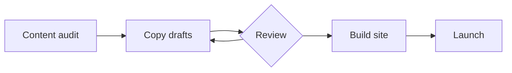

# Website relaunch

Replace the old marketing site with a smaller static site that the whole team can edit as Markdown.

> [!summary] Status — week 3
> Content freeze is on Friday. Design is signed off; two pages still need copy.
> Open questions live in [[Decisions]]; the go-live steps are in [[Launch checklist]].

## Plan

## This week

- [x] Agree on the page list
- [x] Sign off the design
- [ ] Finish copy for *Pricing* and *About*
- [ ] Book the launch slot — see [[Launch checklist]]

## People

| Role | Who |
|---|---|
| Owner | alice |
| Copy | bob |
| Review | [[Decisions\|decision log]] |
